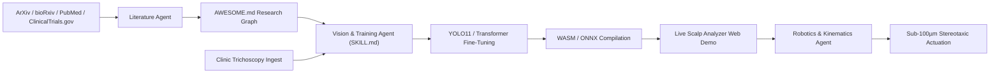

# Open Hair Stack — Commons, Governance & Investment Blueprint
**Architecture:** Decentralized Scientific Commons, Network of Autonomous Agents & Physical AI Commercialization  
**Project Lead:** Salik Shah ([@salik](https://x.com/salik) on X)  
**License Foundation:** Apache 2.0 (Code) · CC BY 4.0 (Data & Documentation)

---

## Executive Summary

Biomedicine is the next frontier of artificial intelligence: empirical, noisy, multivariate, and deeply physical. While closed commercial monopolies lock clinical trichology and surgical transplant robotics inside proprietary \$250,000 black boxes, **Open Hair Stack** establishes a transparent, high-velocity alternative.

This document details the economic architecture, governance model, network-state coordination mechanisms, monetization pathways, and investment roadmap powering the journey from in-browser edge AI to sub-100µm stereotaxic robotic actuation and bio-cloned follicle transplantation.

```
+---------------------------------------------------------------------------------------------------+
|                                 OPEN HAIR STACK ARCHITECTURAL STACK                               |
+---------------------------------------------------------------------------------------------------+
| TIER 3: PHYSICAL AI ROBOTICS & BIO-CLONING (Commercial Hardware & Clinical Spinouts)            |
| • Sub-100µm Stereotaxic 6-DOF Robotic Punch & Actuation End-Effector                              |
| • 3D Tissue-Engineered Dermal Papilla Follicle Organoids & Cell Banking (Tsuji / Stemson Protocols)|
| • Enterprise Clinical Operating Room Appliance (HIPAA/SOC2 Compliant, Calibrated Hardware)       |
+---------------------------------------------------------------------------------------------------+
| TIER 2: NETWORK OF AGENTS & DECENTRALIZED DATA COMMONS (Network State Coordination)               |
| • Autonomous Research Agent Swarms (Literature Ingestion, Synthetic Data, Continuous Evals)       |
| • Client-Side Zero-Knowledge Data Collection (100% In-Browser WASM, Zero Cloud Uploads)          |
| • Multi-Jurisdictional Clinical Validation across Distributed Partner Clinics                     |
+---------------------------------------------------------------------------------------------------+
| TIER 1: THE OPEN SCIENTIFIC COMMONS (Permanent Public Good — Apache 2.0 / CC BY 4.0)              |
| • CC BY 4.0 Multi-Ethnic Trichoscopy Datasets (fu1–fu5 Follicular Units)                         |
| • Open Baseline Weights & ONNX In-Browser Decoders (follicle-fu-v0.1)                             |
| • Standardized Agent Runbooks, Schemas & Research Indexes (SKILL.md & AWESOME.md)                 |
+---------------------------------------------------------------------------------------------------+
```

---

## 1. How the Network State & Decentralized Labs Solve Biomedicine

Centralized biomedical discovery is structurally bottlenecked by:
1. **Regulatory Silos & Geographic Monopolies:** Single-jurisdiction clinical trials take years and millions of dollars to recruit homogenous patient cohorts.
2. **Data Hoarding:** Academic hospitals and private clinics guard small, non-redistributable image sets (e.g., Fudan/Huashan's 1,652 images are request-only and cannot be licensed for open AI training).
3. **Proprietary Hardware Lock-In:** Systems like ARTAS charge \$250,000+ upfront plus proprietary per-graft consumable fees, stifling independent clinical research.

### The Network State Alternative
The Network State model replaces the centralized corporate monopoly with an aligned, distributed network of clinics, researchers, and capital:

* **Decentralized Multi-Ethnic Data Ingestion:** Because Open Hair Stack runs entirely client-side via WebAssembly (zero cloud uploads), clinics in Seoul, Tokyo, Istanbul, São Paulo, and London can run the diagnostic stack on patient trichoscopy photos locally. No protected health information (PHI) ever crosses a border or touches a third-party server.
* **Bounty-Driven Dataset Expansion:** Strategic sponsors and bio-DAOs can fund micro-bounties for rare or underrepresented phenotypes (e.g., Type 4 Afro-textured curly follicular units, scarring alopecias, or post-radiation donor tissue).
* **Parallel Jurisdictional Verification:** Rather than waiting for a single monolithic regulatory clearance, partner clinics in forward-leaning jurisdictions validate model accuracy and stereotaxic safety metrics against standardized open benchmark suites.

---

## 2. The Network of Autonomous Agents

Human researchers alone cannot synthesize the accelerating torrent of biomedical literature and daily model updates. Open Hair Stack deploys a **Network of Specialized AI Agents** operating on standardized interfaces:



1. **Literature Synthesis Agent:** Monitors daily publications across bioRxiv, PubMed, and patent registries for breakthroughs in dermal papilla spheroids, organoid vascularization, and OCT subsurface imaging, automatically updating the repository's research index.
2. **Vision Benchmark Agent:** Runs automated evaluation suites across test splits whenever new annotated trichoscopy batches arrive, asserting mAP50, precision, recall, and class confusion matrices.
3. **Kinematics & Actuation Agent:** Converts 2D pixel coordinates and follicle cluster classifications into 3D stereotaxic entry vectors, optimizing extraction angles to prevent follicle transection.

---

## 3. Ownership, Governance & Intellectual Property

To ensure long-term mission alignment and prevent predatory enclosure, Open Hair Stack maintains an explicit separation between the **Commons Layer** and the **Commercial Application Layer**:

| Layer | Component | Ownership & License | Rationale |
|---|---|---|---|
| **Commons** | Baseline Datasets (CC BY 4.0) | Global Scientific Commons | Maximizes researcher adoption; cannot be retroactively locked or paywalled. |
| **Commons** | Model Weights & WASM Engine | Apache 2.0 / MIT | Guarantees transparent, zero-cost diagnostic access for patients worldwide. |
| **Commons** | Research Harnesses & Skill Files | Apache 2.0 | Enables any autonomous coding agent to contribute without friction. |
| **Commercial** | Certified Clinical Hardware Appliance | Spinout / Device Partner | Turnkey on-premise compute box calibrated for operating room microscopes. |
| **Commercial** | Stereotaxic Robotic End-Effector | Spinout / Engineering Co. | Proprietary micro-machined physical punch, force feedback, and ROS 2 control. |
| **Commercial** | Dermal Papilla Organoid Culture Media | Biotech Partner / Licensee | Proprietary biochemical formulations for scaled follicle organoid multiplication. |

---

## 4. Monetization & Business Model for Commercial Spinouts

Open source creates the standard; commercial products capture enterprise value. A dedicated spinout or commercial operating entity can monetize across four major revenue streams:

### A. Certified Clinical Hardware Appliance ($12,000 – $25,000 / unit)
Hair transplant clinics and dermatologists purchase a certified, plug-and-play edge computing appliance. Features:
* Real-time 4K trichoscopy video stream processing (120 FPS).
* Zero-latency follicular unit counting and density mapping on surgical monitors.
* Pre-calibrated optical distortion profiles for standard trichoscopes (DermLite, Dino-Lite).
* Annual enterprise maintenance, warranty, and regulatory audit compliance ($3,000/yr).

### B. High-Throughput Clinical Tele-Trichology API ($0.10 – $0.50 / analysis)
For telemedicine platforms (e.g., Hims, Keeps, Ro), medical aesthetics networks, and clinical trial sponsors testing hair growth pharmaceuticals:
* B2B cloud API analyzing clinical trial patient scalp images for hair density, shaft thickness, and vellus-to-terminal ratios.
* Longitudinal hair loss tracking reports and automated Norwood/Ludwig staging.

### C. Robotic End-Effector Licensing & Consumables
Following the Intuitive Surgical / da Vinci model:
* Commercial licensing of the sub-100µm stereotaxic toolhead to existing surgical robot manufacturers and medical robotics integrators.
* Sterile, single-use micro-coring punch cartridges ($150–$300 per surgical procedure).

### D. Organoid Bio-Banking & Implantation Services
In partnership with stem cell regenerative medicine labs:
* Cell banking licenses for multiplied patient dermal papilla organoids.
* High-density automated micro-implantation surgical kits.

---

## 5. Strategic Sponsorship & Investment Pathways

We welcome strategic co-development, research grants, and institutional funding across three formal tiers:

### Tier 1: Open Science Research Sponsor ($10,000 – $50,000)
* **Target:** Philanthropic funds, GPU compute providers, biotech non-profits.
* **Deliverables:**
  * Prominent logo placement on GitHub Org, README headers, and Hugging Face Space.
  * Direct funding of open dataset annotation bounties (e.g., 5,000 new clinical trichoscopy images).
  * Compute sponsorship for large-scale vision transformer training runs.

### Tier 2: Clinical Co-Development Partner ($50,000 – $150,000)
* **Target:** Global hair restoration clinics, surgical device manufacturers, telemedicine platforms.
* **Deliverables:**
  * Customized model calibration for specific clinical dermatoscope optical rigs.
  * Co-authorship on peer-reviewed validation papers and clinical trial benchmarks.
  * Early access to v0.2/v0.3 high-resolution oriented bounding box (OBB) model weights.

### Tier 3: Strategic Lead / Pre-Seed Syndicate ($250,000 – $1,000,000)
* **Target:** Deep-tech venture funds, Network State innovation funds, Physical AI syndicates.
* **Deliverables:**
  * Funding the physical engineering of the Phase 3/Phase 4 stereotaxic robotic prototype:
    * 6-DOF robotic manipulator integration.
    * Real-time OCT (Optical Coherence Tomography) subsurface depth sensing.
    * Sub-100µm micro-punch actuation mechanism.
  * Equity / governance participation in the commercial hardware and robotics spinout.

---

## 6. Official Collaboration Intake

For clinical researchers, physical AI engineers, and prospective sponsors:
* **Direct Project Lead:** Salik Shah — [@salik on X](https://x.com/salik) (DMs open for partnerships)
* **Institutional Intake Form:** [https://tally.so/r/o96OkV](https://tally.so/r/o96OkV)
* **GitHub Governance:** [https://github.com/openhairstack/governance](https://github.com/openhairstack/governance)
* **Live Interactive Demo:** [https://huggingface.co/spaces/openhairstack/scalp-analyzer](https://huggingface.co/spaces/openhairstack/scalp-analyzer)
